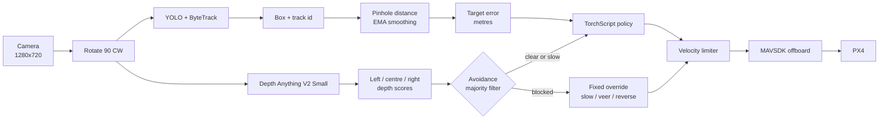

# Vision-Based Target Following and Obstacle Avoidance for a PX4 Aircraft

An autonomous flight stack that steers a multirotor toward a detected target using
only a monocular camera. A YOLO detector with ByteTrack identity persistence finds
the target, a pinhole model turns the bounding box into a distance, and a small
reinforcement-learning actor converts the resulting error into body-frame velocity
commands. A second branch runs Depth Anything V2 on the same frame and can override
the policy when something blocks the flight path. Commands go to PX4 through MAVSDK
offboard control.

This is a final-year engineering project, not a product. It was written to explore
how far a cheap monocular perception stack can get on a real airframe, and the
repository is organised so that the perception, decision and control layers can be
reviewed separately.


## Objective

Build a monocular perception-and-control stack that lets a PX4 multirotor follow a
designated object without external tracking infrastructure: no GPS tag, no motion
capture rig, no depth camera. Add an independent obstacle check so that a perception
failure degrades into slowing down or backing off instead of flying into something.

The engineering question behind the project is how much of the classical pipeline
(detection, geometric ranging, control) can be replaced by learned components while
staying inspectable enough to test on hardware.

## Status

| Area | State |
| --- | --- |
| Flight and perception code | Implemented and running; refactored from a single-file prototype into `src/` |
| Detection weights (`best.pt`) | Not in this repository. Trained outside it; class list and dataset unknown here |
| RL policy (`policy.pt`) | Exported TorchScript actor committed (19.5 KB, 15 -> 32 -> 32 -> 4) |
| RL training code | Not in this repository. Environment, reward and hyperparameters unknown here |
| Unit tests | 22 passing, covering distance maths, velocity limiting, avoidance logic, observation layout |
| Simulation | Configured for PX4 SITL at `udpin://0.0.0.0:14550`; no SITL logs are included |
| Real flight | Unknown from this repository. No flight logs, metrics or video are included, so flying behaviour cannot be verified from what is here |
| Fully autonomous | No. It follows a target that is already visible; it does not search, map, return home or avoid dynamic obstacles |

Read the limitations section before drawing conclusions from this code.

## What it does

Every camera frame goes through the same sequence:

1. Capture at 1280x720, rotate 90 degrees clockwise to match the camera mount.
2. Detect and track the target (YOLO + ByteTrack). Take the bounding box and track id.
3. Estimate range from the box width, smooth it with an EMA, and convert the
   horizontal pixel offset into a lateral offset in metres.
4. Estimate per-frame relative depth with Depth Anything V2 and score the left,
   centre and right thirds of the image.
5. If the centre third is blocked for 3 of the last 5 frames, replace the policy
   command with a fixed avoidance manoeuvre (slow, veer, or reverse).
6. Otherwise, feed the target error and the current velocity to the policy and get
   body-frame `vx`, `vy` and yaw rate back.
7. Rate-limit the horizontal setpoint and publish it to PX4 over MAVSDK offboard.

Landing is handled in a `finally` block: offboard stops, then `action.land()`.

## Features

- Monocular target detection and tracking with persistent ids (YOLO + ByteTrack)
- Bounding-box range estimation with EMA smoothing, no depth sensor required
- Monocular relative depth on the same frames (Depth Anything V2 Small)
- Left/centre/right obstacle scoring with a 3-of-5 majority filter
- Hard override of the learned controller when the centre of the frame is blocked
- Learned horizontal velocity and yaw-rate control from a 15-dim observation
- Body-frame offboard velocity control through MAVSDK with slew limiting
- Automatic takeoff, landing on exit, live OpenCV overlay of box, range, FPS and state
- Display on its own thread, so a slow window does not stall the control loop
- Deterministic, self-contained policy export (19.5 KB, normaliser included)

## Technologies

| Layer | Tools |
| --- | --- |
| Language | Python 3.11 |
| Perception | PyTorch, Ultralytics YOLO, ByteTrack, OpenCV, Pillow |
| Depth | Depth Anything V2 Small through Hugging Face Transformers |
| Learning | PyTorch, TorchScript export of the trained actor |
| Flight | MAVSDK, PX4, offboard velocity control, MAVLink over UDP |
| Numerics | NumPy |
| Tests | pytest |

## Architecture



The policy runs only when a target is visible *and* the avoidance layer has not
taken over. When the override is active the actor is skipped entirely, which also
means its error-history state stops updating (see `docs/CODE_REVIEW.md`).

More detail, including the module map and the state machine, is in
[docs/ARCHITECTURE.md](docs/ARCHITECTURE.md).

## Repository layout

```
.
├── src/
│   ├── main.py              # async control loop, overlay drawing, entry point
│   ├── perception/
│   │   ├── camera.py        # VideoCapture wrapper + frame rotation
│   │   ├── detector.py      # YOLO + ByteTrack, first box selection
│   │   ├── distance.py      # pinhole range, lateral offset, EMA smoother
│   │   └── depth.py         # Depth Anything V2 wrapper, per-frame normalisation
│   ├── navigation/policy.py # TorchScript actor, 15-dim observation, action scaling
│   ├── control/
│   │   ├── flight.py        # MAVSDK connect / takeoff / offboard / land
│   │   └── limiter.py       # per-iteration velocity slew limit
│   ├── avoidance/avoid.py   # thirds scoring + override state machine
│   └── utils/
│       ├── config.py        # every tunable in one place
│       └── gui.py           # OpenCV display on its own thread
├── models/                  # policy.pt lives here; detector weights do not
├── training/                # training code not included; see README inside
├── simulation/              # SITL notes
├── tests/                   # pytest suite for the pure logic
├── examples/                # offline demo, no drone required
└── docs/                    # architecture, code review, publishing notes
```

## Setup

Python 3.11 was used for development.

```bash
git clone <your-repo-url>
cd <repo>
python -m venv .venv
source .venv/bin/activate        # Windows: .venv\Scripts\activate
pip install -r requirements.txt
```

For inference on a GPU, install the matching CUDA build of PyTorch first, then the
rest of the requirements. The code picks `cuda` automatically when
`torch.cuda.is_available()` is true.

Weights:

- `models/policy.pt` is committed and loads with `torch.jit.load`.
- The detector weights are not. Put your checkpoint somewhere out of Git and point
  `MODEL_PATH` at it:

```bash
export MODEL_PATH=/abs/path/to/best.pt
export POLICY_PATH=models/policy.pt   # optional, this is the default
```

## Running

```bash
python -m src.main
```

Against PX4 SITL, start the simulator first so the MAVLink endpoint exists. The
sequence is: wait for `is_global_position_ok`, arm, take off to `SAFE_ALTITUDE`,
wait 10 s, send a zero setpoint, start offboard, then loop. Press `q` in the video
window to leave the loop and land. See [simulation/README.md](simulation/README.md)
for the SITL commands.

## How the perception pipeline works

### Detection and tracking

Ultralytics YOLO runs with `tracker="bytetrack.yaml"` and `persist=True`, so ByteTrack
keeps identity across frames after a detection. Inference runs at `imgsz=800` with a
confidence threshold of 0.25. The tracker wrapper returns the first box in the result
set together with its track id.

ByteTrack does the association, but the loop does not use the id to *select* a target:
it always takes box 0. With a single target class that is usually the same object, and
with two similar objects it can switch between them mid-run.

### Distance estimation

A pinhole model on the bounding-box width:

```
distance_m = REAL_WIDTH_CM * FOCAL_LENGTH_PX / box_width_px / 100
```

With `REAL_WIDTH_CM = 36.4` and `FOCAL_LENGTH_PX = 945`, a 100 px box reads 3.44 m.
The estimate is smoothed with an EMA (`alpha = 0.2`) seeded at 3 m, which trades
latency for stability: a real range change takes several frames to show up.

Both constants are calibration assumptions. They only hold for one target size, one
camera and one zoom level, and the repository contains no calibration script, so
treat the absolute scale as approximate until you verify it against a tape measure.

The horizontal offset is converted the same way:

```
lateral_offset_m = (target_center_x - frame_center_x) / FOCAL_LENGTH_PX * distance_m
```

The resulting vector is `[lateral, 0, forward]`. That ordering is not the usual
NED-style `[forward, right, down]`; whether it matches the training environment is
unverified, and it is the first thing to check if the policy flies badly.

### Depth and obstacle avoidance

Depth Anything V2 (small) runs on the frame resized to 320x320. The output is
relative *inverse* depth: a larger value means the surface is closer. Each frame is
min-max normalised to 0..1, then averaged over the left, centre and right thirds.

The decision logic only looks at the centre third:

| Condition | Command |
| --- | --- |
| Centre above threshold in 3 of the last 5 frames, both sides also above | `REVERSE`, `vx = -0.5` |
| Same, but one side is clearer | `VEER LEFT` (`vx = 0.3`, `vy = +0.5`) or `VEER RIGHT` (`vy = -0.5`) |
| Centre above 70% of the threshold | `SLOW`, `vx = 0.2` |
| Otherwise | `CLEAR`, the policy keeps control |

The 3-of-5 majority filter stops single-frame depth noise from twitching the setpoint.
Because normalisation is per frame, `DANGER_THRESHOLD = 0.355` is a relative number:
it means "the centre looks closer than most of the rest of this frame", not
"0.355 of anything physical". A darker, flatter scene can push the same obstacle
across or under the threshold.

Only the centre third can trigger the hard override. An obstacle that fills the right
third and nothing else does not change the command. `examples/demo_avoidance.py`
shows exactly that.

## How the RL inference pipeline works

`policy.pt` is a TorchScript module: an `EmpiricalNormalization` layer in front of a
32-32 ELU MLP that maps 15 observations to 4 action values. The normalisation is
inside the exported module, so the loop passes raw (scaled) features.

Observation layout, in order:

| Indices | Content | Scaling | Frame |
| --- | --- | --- | --- |
| 0-2 | vehicle velocity | x0.1 | NED, from `telemetry.velocity_ned()` |
| 3-5 | unused, filled with zeros | x0.1 | n/a |
| 6-8 | gravity direction `[0, 0, -1]` | none | body |
| 9-11 | target error `[lateral, 0, forward]` | x0.2 | metres, camera-derived |
| 12-14 | error change since the last policy call, x10 | x0.1 | same as above |

Action layout:

| Index | Meaning | Applied as |
| --- | --- | --- |
| 0 | forward command | `action[0] * MAX_SPEED`, clipped to +-0.7 m/s |
| 1 | lateral command | `action[1] * MAX_SPEED`, clipped to +-0.7 m/s |
| 2 | not used | vertical setpoint is always 0 (PX4 holds altitude) |
| 3 | yaw rate | `action[3] * MAX_YAW`, clipped to +-15 deg/s |

Measured on this machine (CPU, single sample, 500 iterations), the actor costs about
**0.23 ms per call**. The policy is not the bottleneck; the detector and the depth
model are, by a wide margin. No latency budget for those two is claimed here because
they were not benchmarked as part of this repository.

## Flight control and PX4 integration

`src/control/flight.py` wraps the MAVSDK calls and `src/main.py` owns the sequence:

```
connect(udpin://0.0.0.0:14550)
  -> wait for health.is_global_position_ok
  -> set_takeoff_altitude(3.0), arm(), takeoff()
  -> sleep 10 s
  -> set_velocity_body(0,0,0,0), offboard.start()
  -> loop: set_velocity_body(vx, vy, 0, yaw_rate) at camera rate
  -> finally: offboard.stop(), land()
```

`VelocityBodyYawspeed` is body-frame FRD (x forward, y right, z down) with yaw rate in
degrees per second. The telemetry velocity used in the observation is NED. The two
frames are mixed in the same loop; this is intentional only if the training
environment did the same, which is the main open question about the controller.

Altitude is never commanded in the loop: `z` is always 0, so PX4 holds the current
altitude while the loop controls horizontal velocity and yaw rate.

## Configuration

Everything lives in `src/utils/config.py`.

| Name | Value | Meaning |
| --- | --- | --- |
| `MODEL_PATH` | `models/best.pt` | detector weights, override with `$MODEL_PATH` |
| `POLICY_PATH` | `models/policy.pt` | exported actor |
| `CONNECTION_URL` | `udpin://0.0.0.0:14550` | MAVLink endpoint |
| `VIDEO_SOURCE` | `1` | OpenCV camera index |
| `CONF_THRESHOLD` | `0.25` | detector confidence |
| `IMG_SIZE` | `800` | detector inference size |
| `REAL_WIDTH_CM` | `36.4` | assumed target width |
| `FOCAL_LENGTH_PX` | `945.0` | assumed focal length |
| `SMOOTHING_FACTOR` | `0.2` | distance EMA weight |
| `SAFE_ALTITUDE` | `3.0` m | takeoff altitude |
| `MAX_SPEED` | `0.7` m/s | policy output scale |
| `MAX_ACCEL` | `0.08` | velocity change allowed **per loop iteration** |
| `MAX_YAW` | `15.0` deg/s | policy yaw scale |
| `DANGER_THRESHOLD` | `0.355` | normalised depth that counts as blocked |
| `BUFFER_SIZE` | `5` | frames in the avoidance majority filter |
| `DEPTH_INPUT_SIZE` | `320` | depth model input, square |

`MAX_ACCEL` is the one to watch: it is a per-iteration delta, so the real
acceleration is `0.08 * loop_rate`. At 10 Hz that is 0.8 m/s^2; at 25 Hz it is
2.0 m/s^2. The loop rate is whatever the detector and depth model allow.

## Tests

```bash
pip install -r requirements-dev.txt
python -m pytest tests -q
```

The suite covers the parts that do not need hardware: pinhole distance maths and
smoothing, the velocity limiter's step behaviour and reversal cost, the avoidance
state machine including the majority filter and the near-band slow command, and the
15-dim observation layout (checked against the exported actor, which rejects anything
that is not 15 wide).

Nothing here tests flight. There is no SITL integration test and no replay of recorded
flights, so the tests say nothing about whether the aircraft behaves correctly. For the
simulation workflow itself (PX4 SITL, MAVLink endpoint, camera source), see
[simulation/README.md](simulation/README.md).

## Training workflow

The training code is not part of this repository; `models/policy.pt` is its output.
Known structure of the exported module and the full list of unknowns are documented in
[training/README.md](training/README.md). In short: an SB3-style PPO actor was trained,
snapshots (`model_0.pt` ... `model_150.pt`) and TensorBoard events were produced, and
none of those artefacts belong in Git.

## Output and visualisation

Two OpenCV windows run on a separate thread so `imshow` never blocks the asyncio loop:

- **Target Follower**: the camera frame with the target box, track id, smoothed range,
  current FPS and the avoidance state.
- **Depth Map**: the normalised depth as `COLORMAP_MAGMA` with the same state label.

Depth colour is per frame, so the palette shifting between frames is expected.

The offline demo produces a still without a drone:

```bash
python examples/demo_avoidance.py
```

---

## Limitations

Verified against the code and the test suite, not guessed:

- **Centre-only obstacle check.** An obstacle occupying the right or left third alone
  produces no reaction. The demo script shows this on the first four obstacle frames.
- **Relative depth threshold.** Per-frame min-max normalisation makes
  `DANGER_THRESHOLD` scene-dependent, and the data it was calibrated on is not recorded
  in this repository.
- **Per-iteration acceleration limit.** `MAX_ACCEL` does not scale with `dt`.
- **Yaw is not rate-limited.** It is clipped to +-15 deg/s but can jump between frames,
  including to zero when the override engages.
- **No target reselection.** Box 0 is always used, so two similar objects can cause a
  switch. Losing the target means hovering with zero command; there is no search
  behaviour, no re-acquire pattern and no hover timeout.
- **Stale error history.** The policy's error history stops updating while the
  avoidance layer is in control, so the first policy call afterwards sees one large
  rate value.
- **Frame convention risk.** NED velocity is fed to a policy that also receives a
  camera-derived `[lateral, 0, forward]` error, while commands go out in body FRD. This
  matches the training environment only if that environment did the same.
- **Blocking inference.** Detector and depth inference run in the asyncio loop, so a
  slow frame delays MAVLink setpoints. PX4's offboard failsafe is a real constraint
  here and is not explicitly managed.
- **No failsafes beyond landing.** No geofence, no return-to-home, no battery check, no
  RC-override handling, no setpoint watchdog.
- **Single-file-scale testing.** No CI, no SITL test, no recorded-flight replay.
- **Calibration constants** (`REAL_WIDTH_CM`, `FOCAL_LENGTH_PX`) are assumed, and the
  repository has no calibration procedure.

Known algorithmic issues are catalogued with severity and suggested fixes in
[docs/CODE_REVIEW.md](docs/CODE_REVIEW.md).

## Roadmap and future work

Ordered by what would make the project more trustworthy, not by what is most fun:

1. Log every frame index, setpoint, telemetry sample and avoidance state to a CSV or
   rosbag-style file, then replay it through the loop offline. Without this, nothing
   else can be validated.
2. Verify the observation vector against the training environment, then fix the frame
   conventions in one place (a single body-frame conversion at the boundary).
3. Replace the per-iteration acceleration limit with a time-based one and add a yaw
   rate limiter.
4. Make the depth check use metric or calibrated depth instead of per-frame normalised
   relative depth, or at least normalise against a running reference.
5. Add a setpoint watchdog and offboard timeout, an RC override path, and a geofence.
6. Add lost-target behaviour: search pattern, hover timeout, then land or return.
7. Publish the training environment and configs so the policy can be retrained.
8. Add a SITL test that runs the loop for a fixed number of iterations against a fake
   MAVSDK backend and asserts the setpoint sequence.

## Safety

This code commands a real aircraft. It has no hardware failsafes of its own.

- Test in SITL first, and keep a pilot with an RC transmitter ready to take over.
- Fly with prop guards, in an open area, within line of sight, and within whatever
  rules apply where you are.
- `finally` blocks are not a failsafe. If the process is killed, or the loop raises
  before offboard is stopped, the aircraft is left in whatever mode it was in. PX4's
  own failsafe configuration is what keeps it safe, not this script.
- The depth threshold was tuned on specific recordings. Do not assume it transfers to
  a new camera, lens or lighting condition.

Scope: this project is about perception, state estimation and control for autonomous
navigation. It does not include, and the documentation does not describe, weaponisation,
targeting of people, or payload deployment. If you fork it, keep it that way.

## Model files

`policy.pt` is committed because it is 19.5 KB. Detector weights, training snapshots
and TensorBoard logs are not, and should not be pushed to a normal Git remote. Options
(GitHub Releases, Git LFS, external storage) and the trade-offs are in
[models/README.md](models/README.md).

## License

MIT. See [LICENSE](LICENSE). Replace `<YOUR NAME>` in the copyright line before
publishing.
