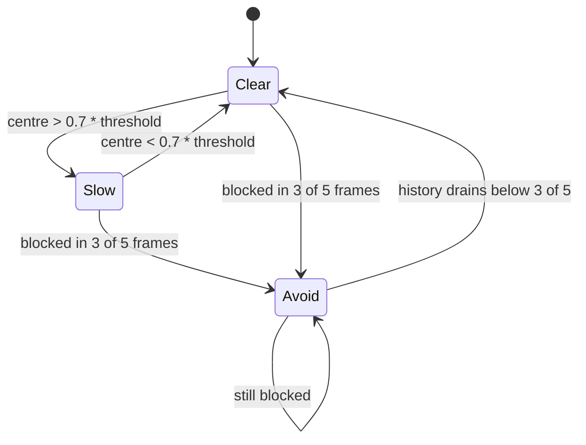

# Architecture

## Module map

| Module | Responsibility | Depends on |
| --- | --- | --- |
| `src/main.py` | Loop, command arbitration, overlay, lifecycle | everything below |
| `src/perception/camera.py` | `VideoCapture` setup, frame read, 90 deg rotation | OpenCV |
| `src/perception/detector.py` | YOLO + ByteTrack, returns `Target(box, track_id)` | ultralytics |
| `src/perception/distance.py` | Pinhole range, lateral offset, EMA smoothing | pure maths |
| `src/perception/depth.py` | Depth Anything V2 inference, per-frame normalisation | transformers, Pillow |
| `src/navigation/policy.py` | Observation assembly, TorchScript forward, action scaling | torch |
| `src/control/flight.py` | MAVSDK connect, takeoff, offboard setpoints, land | mavsdk |
| `src/control/limiter.py` | Per-axis slew limit on the horizontal setpoint | none |
| `src/avoidance/avoid.py` | Thirds scoring, majority filter, override command | numpy |
| `src/utils/config.py` | Constants and environment overrides | none |
| `src/utils/gui.py` | OpenCV windows on a background thread | OpenCV |

Only `main.py` wires modules together. The leaf modules take plain numbers and
arrays, so they can be exercised without a drone, a camera or model weights.

## Data shapes

| Stage | Shape / type |
| --- | --- |
| Camera frame | `(1280, 720, 3)` uint8 BGR after the 90 deg rotation of a 1280x720 capture |
| Detection | 4 floats `x1, y1, x2, y2` in pixels plus an int track id |
| Target error | 3 floats `[lateral_m, 0.0, forward_m]` |
| Depth input | `(320, 320, 3)` RGB, resized and colour-converted |
| Depth map | `(320, 320)` float32, min-max normalised to 0..1, higher = closer |
| Observation | 15 float32, see the table in the main README |
| Action | 4 float32; indices 0, 1 and 3 are used |
| Setpoint | `VelocityBodyYawspeed(vx, vy, 0.0, yaw_rate_deg_s)` |

## Control loop

One iteration, in order. Everything is sequential inside one asyncio task.

```
read frame                     (camera, blocking)
detect + track                 (GPU/CPU, blocking, dominant cost)
distance + error               (microseconds)
depth inference                (GPU/CPU, blocking, second dominant cost)
avoidance decision             (microseconds)
if target and no override:
    read NED velocity          (awaits the next telemetry message)
    policy forward             (~0.23 ms measured on CPU)
arbitrate command
slew limit                     (horizontal only)
publish setpoint               (await, ~50 Hz link limit)
draw overlay + queue to GUI
sleep 1 ms
```

The loop rate is therefore set by the detector and the depth model. `sleep(1e-3)`
is not a control period, it is a yield. Two consequences follow:

- `MAX_ACCEL = 0.08` is a *per-iteration* delta. Effective acceleration is
  `0.08 * loop_rate` in m/s^2.
- MAVLink setpoints are only as fresh as the slowest inference call, which matters
  because PX4 drops out of offboard when the setpoint stream stalls.

## Threading and concurrency

- **Main thread**: one asyncio event loop running the camera, inference, arbitration
  and MAVSDK calls. MAVSDK's own connection handling runs as tasks on the same loop,
  so a long blocking inference call also delays telemetry processing.
- **GUI thread**: `GUIThread` owns `cv2.namedWindow` / `imshow` / `waitKey`, fed by a
  queue of size 2. Frames are dropped when the display falls behind, so a slow
  window never stalls the loop. `q` sets `exit_flag`, which is how the loop ends.
- **Telemetry**: `velocity_ned()` opens a stream, takes the first sample and drops
  the generator. That is one short-lived stream per control iteration.

## Command arbitration



Arbitration rules in `main.py`:

1. No target and no override -> zero setpoint, limiter ramps down.
2. Target and no override -> policy command.
3. Override -> fixed command from the avoidance layer, yaw forced to zero, policy
   skipped.

The limiter is applied after arbitration, so even the fixed avoidance setpoints are
reached through the 0.08-per-iteration ramp.

## Failure paths

| Failure | Current behaviour |
| --- | --- |
| Camera read fails | Loop breaks, `finally` stops offboard and lands |
| No position estimate | Blocks forever waiting on `is_global_position_ok` |
| `offboard.start()` raises | Logs the error, lands, returns |
| Exception inside the loop | `finally` runs: stop offboard, land, release camera |
| `q` pressed | Same as a normal exit |
| Process killed / SIGKILL | No landing command is sent; PX4 failsafe decides |
| Target lost | Zero setpoint, hover, no timeout |

## Where to extend

- New detector or tracker: replace `TargetTracker.update` and keep the
  `Target(box, track_id)` contract.
- Different depth backend: implement `infer(frame) -> normalised map` in
  `perception/depth.py`; the avoidance layer only reads arrays.
- New controller: replace `TargetPolicy.act(velocity_ned, error) -> (vx, vy, yaw)`.
  Keeping the signature means `main.py` does not change.
- Additional safety layer: add it between arbitration and the limiter, where both
  the policy and the override commands are already resolved.
